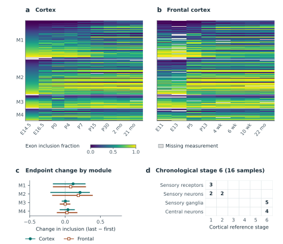
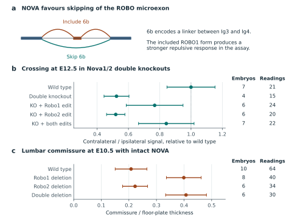
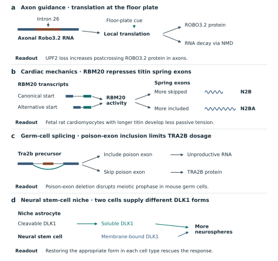
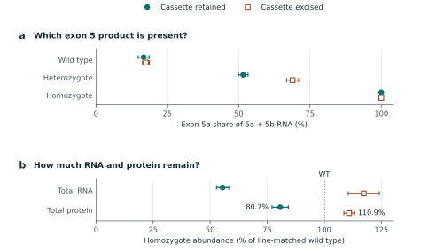
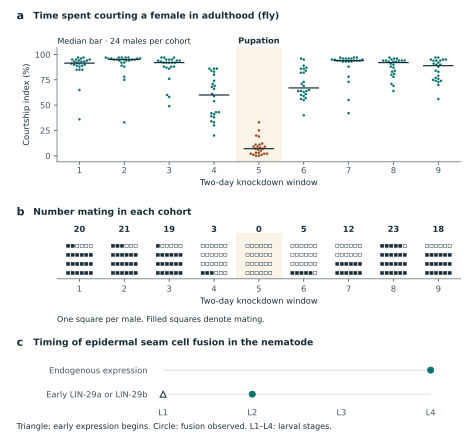
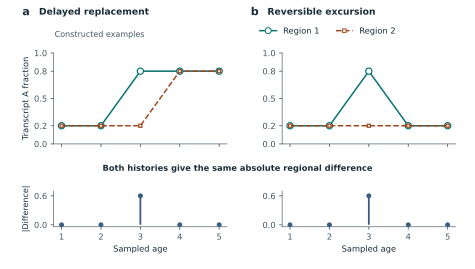

# Transcript switches and the timing of development

Authors: Robin Gounder1, Samuel Schmidt2,3  
1University of Cambridge  
2Vaionex Corporation  
3Cornell University

Date: 18 November 2026

## Abstract

An RNA isoform that becomes abundant as a tissue matures may mark a change in cell composition, alter the fate of a progenitor or help determine when a developmental event occurs. These possibilities make different predictions. In mouse cortical progenitors, expression of the neuronal form of ninein favours production of neurons. In the nematode epidermis, early expression of either LIN-29 isoform brings cell fusion forward by two larval stages. In flies, a brief perturbation of the male-specific *fruitless* protein around pupation impairs courtship in adulthood. These experiments respectively change the probability of a fate, the onset of a transition and the capacity for a later behaviour. We examine how studies can distinguish a shift in transcript usage, the appearance of a functional protein and the onset of a phenotype. A causal account of endogenous isoform replacement must connect these observations in the responding lineage and identify the source of the product when it acts across cells.

Keywords: alternative splicing; differential transcript usage; developmental timing; microexons; axon guidance; nonsense-mediated decay; isoform function

## Introduction

Commissural axons in the embryonic spinal cord must approach the midline, cross it and then respond to repulsive cues that limit recrossing. In mice, deleting a short exon in *Robo1* changes the early pattern of crossing. A cue from the floor plate, a specialised region at the ventral midline, triggers local translation of a second receptor isoform, ROBO3.2, from RNA already present in the distal axon [@Johnson2019;@Chen2008;@Colak2013]. Sampling RNA at successive ages can reveal a change in exon use. Identifying cue-dependent translation requires localising protein synthesis relative to the floor plate.

In developing human cortex, Patowary and colleagues compared the progenitor-rich germinal zone with the neuron-rich cortical plate. Of 10,809 genes with multiple expressed isoforms, 2,679 differed in transcript proportions between the two regions. Two previously unannotated *SMARCC2* transcripts were preferentially used in the germinal zone, although total *SMARCC2* expression showed no significant regional difference [@Patowary2024]. The regional difference could arise if progenitors change isoform usage as they differentiate, if the two regions differ in cellular composition, or through both processes.

Previous reviews describe the regulation, measurement and developmental functions of alternative splicing [@Kalsotra2011;@Choquet2025;@Sousa2026]. Here we ask what evidence would establish that changing which transcript a gene makes helps set the time of a developmental event. Three observations bear on that question. Transcript measurements establish when usage changes within a lineage. Measurements of protein abundance and location establish when the altered product reaches the cells or compartments in which it acts. A shift in the onset of an independently scored event after isoform-specific perturbation tests whether the product can influence timing. These observations can come apart. A stored RNA may be translated only at an anatomical boundary, and a protein needed to build a circuit may have its first measurable behavioural consequence much later.

## What a switch atlas measures

Transcript usage is the fraction of a gene's measured RNA attributable to each transcript isoform. Differential transcript usage means that those fractions change between samples. A switch in the dominant transcript requires a change in which form is most abundant. With two forms, a fall from 51% to 49% exchanges their ranks. A fall from 80% to 60% changes that fraction by ten times as much while preserving their order. To infer synaptic protein abundance from either shift, one would also need to know the absolute transcript abundance, how efficiently and where the RNA is translated, and how much protein reaches and persists at the synapse.

### What cortical exon usage reveals about age

Weyn-Vanhentenryck and colleagues grouped cassette exons in developing mouse cortex by how their inclusion changed with age [@Weyn2018]. A cassette exon can be included in or skipped from a mature RNA. Its inclusion fraction, often reported as percent spliced in (PSI), estimates what proportion of transcripts spanning the event contain the exon. Figure 1 follows the same 2,883 exon events through two cortical age series, keeping the row order fixed. Several exons can come from one gene, and several full-length transcripts can carry the same exon.

The endpoint comparison uses the 2,577 events measured at the first and last age in both series. In module M2, the median within-exon increase in inclusion was 21 percentage points in cortex and 19 in frontal cortex. In M3, the median within-exon change was close to zero in both series, although some exons increased in inclusion and others decreased (Figure 1c). The interquartile ranges summarise variation among exons within each module.

When the cortical splicing stages were applied to other neuronal populations, all 16 samples in Figure 1d belonged to the latest chronological age group. Yet all three sensory receptor samples scored at cortical stage 1, while all four central neuron samples scored at stage 6 [@Weyn2018]. Low cortical stage scores in sensory cells are compatible with a lineage-specific exon programme that persists at maturity. Establishing a delay would require following that sensory lineage through its own maturation.

Across seven organs in six mammals and chicken, developmentally changing splicing events were more conserved than events with stable usage [@Mazin2021]. Conservation makes a reproducible switch a stronger candidate for functional study. Models of splicing error also predict many rare products whose prevalence depends on expression and the cost of misprocessing [@Saudemont2017]. An exon used reproducibly at the same developmental stage across species therefore has a different evidential basis from a rare isoform detected in a single sample.

### Which cells contribute the RNA?

A bulk sample weights each cell type by how much of the gene's RNA it contributes. In a two-cell-type example, an isoform accounts for 80% of a gene's RNA in type A and 20% in type B. Each A cell produces four times as much RNA from the gene as each B cell. Reducing the proportion of A cells from 80% to 20% lowers the pooled isoform fraction from about 76% to 50%, even with fixed usage in each cell type. Interpreting a bulk shift therefore requires estimates of both cell composition and gene expression per cell type. Profiles from the same donors, compared within a defined lineage and maturation state, can test whether the regional difference persists [@Joglekar2024;@Patowary2024].

In differentiating mouse muscle cells, a previously unannotated first exon distinguished an early *Fhl3* transcript from the form that predominated later. Detection of the new first exon supported the transcript assembly and suggested that the dominant transcription start site changed during differentiation [@Trapnell2010]. Long reads can link a transcript's start to its internal exons and end. Recovery of complete transcript ends and rare isoforms varies across protocols [@Glinos2022;@LRGASP2024]. For *SMARCC2*, estimating each isoform's share across ages requires reads that distinguish the two transcripts in matched cell populations. Reads confined to a junction common to both forms cannot resolve their relative abundance.

The mouse cortical ninein gene (*Nin*) illustrates how to move beyond a regional comparison. Inclusion of exon 29 changes the carboxyl terminus of ninein and disrupts its association with the centrosomal protein CEP250. Zhang and colleagues expressed the neuronal or progenitor isoform in embryonic mouse cortex at day 13.5. Two days later, fewer labelled cells remained in the ventricular zone after expression of the neuronal form. Position alone is ambiguous because migration also changed. When individual progenitors were isolated and their daughter cells scored, the neuronal isoform favoured production of neurons [@Zhang2016Nin]. This experiment identifies a change in daughter-cell fate. Measuring the interval to differentiation in those daughters would address the distinct question of developmental timing.

## Which molecular step sets the time of action?

In commissural axons, developmental regulation acts at two steps in receptor production. Splicing determines which ROBO1 receptor form is available for signalling, and a floor-plate cue regulates local synthesis of ROBO3.2 from RNA already present in the axon.

### A microexon and the onset of midline crossing

*Robo1* and *Robo2* contain a conserved microexon, 6b, encoding a short linker between extracellular immunoglobulin-like domains. In rat dorsal spinal cord, the exon-included forms predominated early and declined from embryonic day 11 to 14 as expression of the NOVA splicing regulators increased. In mouse mutants lacking *Nova1* and *Nova2*, inclusion increased. Reporter experiments traced repression to sequences flanking the microexon. The two ROBO1 forms showed similar binding to the SLIT2 ligand fragment used in the assay. In transfected cells, SLIT2 stimulation produced stronger RAC1 activation and CDC42 inhibition with the exon-included form [@Johnson2019]. The relative surface abundance of the two receptors in embryonic growth cones remains unknown.

Removing both NOVA regulators impairs midline crossing. To estimate the contribution of *Robo1* and *Robo2* splicing to this defect, Johnson and colleagues deleted one genomic copy of exon 6b at one or both receptor genes in mice lacking *Nova1* and *Nova2*. The ratio of contralateral to ipsilateral axon labelling, normalised to wild type, rose from 0.52 in the double mutant to 0.77 with the *Robo1* edit and 0.84 with both edits. The *Robo2* edit alone gave 0.52 (Figure 2b). In mice with intact NOVA regulation, deleting both copies of *Robo1* exon 6b increased lumbar commissure thickness early in development, when many axons were approaching the midline. The thickness difference seen in the lumbar cord was absent at the brachial level, where crossing was further advanced [@Johnson2019].

The two experiments establish that *Robo1* exon 6b influences midline crossing (Figure 2). Commissure thickness at a single age cannot distinguish earlier arrival from a change in the number or packing of axons at the floor plate. Following individual axons from approach to exit would distinguish those explanations.

### A midline cue triggers local translation

ROBO3.1 helps commissural axons enter and cross the midline. ROBO3.2 limits recrossing on the far side [@Chen2008]. Axons contain *Robo3.2* RNA before crossing. In spinal explants, medium conditioned by floor-plate tissue induced local production of ROBO3.2 protein. Retention of intron 26 places a stop codon upstream of the final exon junction. When the axon translates *Robo3.2*, that arrangement makes the RNA susceptible to nonsense-mediated decay [@Colak2013]. Disrupting the decay factor UPF2 in commissural neurons increased postcrossing ROBO3.2 and altered axon trajectories [@Colak2013]. The floor-plate cue thus allows the axon to make protein from a stored transcript while coupling its use to loss of the template (Figure 3a).

Before crossing, *Robo1* exon 6b inclusion reports the relative abundance of transcripts encoding the two receptor forms. For *Robo3*, measuring axonal RNA and newly synthesised protein on either side of the floor plate could locate the onset of translation. Newly translated ROBO3.2 can accumulate even as its RNA declines. A measurement from the whole spinal cord pools axons that have yet to encounter the cue with those that have already crossed.

## How does isoform choice alter protein function?

Alternative splicing can change a protein's mechanical properties, limit its abundance or alter its interactions with other proteins. Titin, TRA2B and MEF2D illustrate these three consequences in developing tissues.

### Changes in protein mechanics, dose and activity

In rat heart, a 3.7-MDa N2BA form of titin was present before birth. By one week after birth, the smaller 3.0-MDa N2B form predominated. When stretched, fetal cardiomyocytes developed approximately one-fifteenth the titin-based passive tension of adult cardiomyocytes. A model of elasticity related the force to the length of the extensible region [@Opitz2004]. These measurements link titin spring length to passive tension in developing cardiomyocytes. Several transcripts can encode proteins that migrate in the same band, limiting assignment of the mechanical phenotype to an individual transcript.

RBM20 regulates splicing of the titin spring exons [@Guo2012RBM20]. Transcription from an internal *Rbm20* start site allows translation to initiate in exon 2, producing a shorter, active splicing regulator. Mice with the canonical start disrupted retained some RBM20 activity. Titin splicing and cardiac compliance in these mice fell between the values in wild-type mice and those lacking the regulator's RNA-binding motif [@Radke2026]. Residual activity can therefore preserve some repression of titin spring exons after loss of the canonical start (Figure 3b).

In mouse germ cells, the *Tra2b* transcript can include a poison exon that introduces a premature stop codon and targets the RNA for decay. TRA2B promotes inclusion of its own poison exon, providing negative feedback. Deleting the exon increased *Tra2b* expression and disrupted downstream splicing. Germ cells died during meiotic prophase, whereas earlier dividing germ cells were spared by the exon deletion [@Dalgliesh2025]. The poison exon is also regulated in activated T cells [@Karginov2024]. Its reuse outside the germ line illustrates why the stage of cell loss must be established separately in each lineage. Restoring TRA2B to its normal abundance in mutant germ cells would test whether excess regulator contributes to meiotic cell loss (Figure 3c).

As skeletal muscle precursors (myoblasts) differentiate, alternative splicing produces a MEF2D form that escapes inhibitory phosphorylation and recruits a coactivator to muscle genes [@Sebastian2013]. In cells depleted of RBFOX proteins, supplying the muscle-specific form improved differentiation. The ubiquitous form failed to do so [@Runfola2015]. In a separate comparison with similar amounts of the introduced proteins, the muscle-specific form partially restored fusion of myoblasts depleted of RBFOX2 [@Singh2014]. Depleting a second RBFOX2 target, ROCK2, also partially restored fusion [@Singh2014]. These experiments implicate multiple splicing targets in the phenotype. Rescue at successive stages could establish when the muscle-specific MEF2D form is required.

### DLK1 splice forms serve different roles in two neural stem-cell niches

In the postnatal mouse subventricular zone, astrocytes favour *Dlk1* splice forms that retain a protein cleavage site. A protease can therefore release soluble DLK1 from the cell surface. Neighbouring neural stem cells favour forms that lack the site and remain membrane-bound. Ferrón, Ferguson-Smith and colleagues restored one form at a time to cells lacking *Dlk1*. Astrocytes supplied with the soluble form again stimulated neurosphere formation by wild-type stem cells in co-culture. In the reciprocal experiment, soluble DLK1 stimulated neurosphere formation by mutant stem cells only if those cells expressed the membrane-bound form (Figure 3d) [@Ferron2011].

Reciprocal crosses in the same study used sequence variants to distinguish transcripts from the maternal and paternal alleles. At birth, neural stem cells and niche astrocytes expressed the paternal *Dlk1* allele. By postnatal day 7, both alleles contributed, even though an assay of the whole subventricular zone still indicated expression only from the paternal allele. Both splice-form classes could be expressed from either allele [@Ferron2011]. These measurements place the first detectable contribution from the maternal allele within the first postnatal week. Dating the emergence of the splice preference would require measuring the relative abundance of both forms in each cell population over that interval.

In the adult hippocampus, Montalbán-Loro and colleagues found that stem cells in the dentate gyrus preferentially expressed the cleavable form. Differentiated astrocytes from that niche expressed little *Dlk1*. Deleting either parental copy in cells expressing glial fibrillary acidic protein (GFAP) reduced the number of immature neurons in the dentate gyrus [@Montalban2021]. Both parental alleles contribute to neurogenesis in each niche, while the splice form favoured by neural stem cells differs between the dentate gyrus and the subventricular zone.

During water-maze training, mice lacking either parental copy of *Dlk1* in GFAP-expressing cells reached the platform progressively faster, as did controls. Once the platform was removed, controls concentrated their search in its former quadrant. Mutants showed no preference among quadrants. Because the deletion persisted, the spatial memory deficit could reflect altered circuit development, an ongoing requirement for DLK1 in adulthood, or both [@Montalban2021].

### Protein identity and dose at the synapse

SNAP-25 contributes to the fusion of synaptic vesicles with the presynaptic membrane. Two mutually exclusive versions of exon 5 encode variants that differ by nine amino acids. In postnatal mouse hippocampus, the *Snap25a* transcript accounts for a larger share of *Snap25* RNA in granule neuroblasts than in mature excitatory neurons. Some inhibitory precursors already use exon 5b more frequently than excitatory precursors [@Joglekar2021]. In rat brain, the b protein rises markedly after birth, while the a protein can also rise [@Prescott2011]. As the total amount increases, a form that loses RNA share can still accumulate as protein.

Johansson and colleagues replaced the b coding sequence with a second copy encoding a. Both homozygous mouse lines made only the a form. With a selection cassette retained, total brain SNAP-25 protein averaged 80.7% of the line's wild-type level. After excision it averaged 110.9% of the corresponding control (Figure 4). Paired-pulse facilitation measures how much the synaptic response increases on the second of two closely spaced stimuli. In hippocampal slices from 12- to 16-day-old mice from the excised line, facilitation was weaker than in controls when stimulus pairs were delivered at 0.2 Hz. At 0.5 Hz the estimated difference did not reach statistical significance (P = 0.085) [@Johansson2008].

In older mice from the excised line, plasma membrane fractions contained less SNAP-25 than in controls. The size of the reduction depended on the antibody used, and the comparison included three mice per genotype. These data suggest altered localisation in older mice. Membrane-associated SNAP-25 abundance in the younger mice used for the synaptic recordings remains unknown [@Johansson2008]. Restoring the b form at different ages could distinguish an early role in building the circuit from an ongoing role in transmission. Interpreting early rescue requires evidence that the introduced protein has cleared from synapses before recording. Interpreting late rescue requires confirmation that the protein has reached the synapse.

## When is a product required?

An isoform-specific rescue establishes that the supplied product can support a function. Its timing can be tested in two directions. Advancing expression asks whether cells become competent to carry out the event early. Restricting depletion to successive stages asks when expression is needed for a later outcome. These experiments are especially informative when the duration of protein exposure and the onset of the phenotype can be measured independently.

### Advancing an epidermal transition and perturbing a future circuit

In the epidermis of *Caenorhabditis elegans*, lateral seam cells normally fuse during the fourth larval stage. Nuclear staining in these cells revealed LIN-29b late in the third larval stage and LIN-29a only midway through the fourth. Isoform-specific mutants showed that seam cell fusion requires LIN-29b and proceeds in the absence of LIN-29a [@Azzi2020]. Azzi and colleagues expressed each isoform separately under an epidermal promoter active from the first larval stage. By early in the second stage, more than 90% of animals in each group showed complete seam cell fusion. Gonad morphology independently placed these animals in early L2 (Figure 5c) [@Azzi2020]. The two proteins are under different temporal controls. LIN-41 represses translation of *lin-29a* RNA, whereas HBL-1 delays LIN-29b accumulation through a mechanism that may be indirect [@Azzi2020]. Either protein can promote fusion when present early. The experiment therefore places a timing function at the level of LIN-29 availability, while leaving open whether changing the endogenous ratio of the isoforms at a fixed total dose would advance fusion.

In fruit flies, Chen and colleagues induced knockdown of the male-specific *fruitless* product, FruM, for two days in each of nine cohorts spanning development and early adult life. They measured the fraction of time adult males spent courting females. The median was 7% after knockdown around pupation, compared with 60% and 67% in the adjacent windows. Of 24 males per cohort, three mated after knockdown in the preceding window, none in the pupal window and five in the following window (Figure 5) [@Chen2021Fru]. Brain staining confirmed that FruM fell after induction at stages 5 and 7. Adults exposed at stage 5 again showed strong FruM staining despite the courtship deficit. Adults exposed at stages 6–9 retained less staining, although their female-directed courtship was less impaired [@Chen2021Fru]. Adult brain staining was therefore a poor predictor of courtship across these cohorts. Staining establishes that FruM was detectable again in adulthood after stage-5 induction, but it cannot date recovery in the neurons that support courtship.

### Placental compensation delays the onset of fetal growth restriction

At the imprinted mouse *Igf2* locus, the P0 promoter drives expression of a transcript specific to the labyrinthine trophoblast at the maternal–fetal exchange surface. Constância, Ferguson-Smith and colleagues examined mice lacking this transcript. Placental growth restriction preceded fetal growth restriction. Increased active amino acid transport initially helped sustain fetal growth despite reduced passive nutrient transfer [@Constancia2002].

A follow-up compared loss of P0 alone with loss of *Igf2* throughout the fetus and placenta. On embryonic day 14, P0 mutant placentas weighed 82% as much as wild-type littermate placentas, but their fetuses averaged 99% of wild-type weight. In the complete knockout, the corresponding values were 79% and 78%. By day 19, fetal weight in the P0 mutants had fallen to 75% of wild type. Tracer measurements on day 16 showed that the P0 mutant placenta transferred 58% more glucose per gram of placenta than its wild-type counterpart. This compensatory increase was absent in the complete knockout [@Constancia2005]. Thus the age at which fetal weight diverges depends partly on how much transport the remaining placental tissue can sustain. The constitutive deletion identifies a requirement for P0 expression. Testing whether promoter choice itself changes during gestation would require measuring transcripts from each *Igf2* start site.

A delayed phenotype can thus arise even when the initiating lesion persists from the outset. At *Igf2*, transport per gram of placenta can temporarily compensate for reduced placental mass. At *fruitless*, a short period of depletion leaves a deficit apparent after FruM has reappeared in the adult brain. In both cases the age at which the phenotype becomes measurable provides an incomplete guide to when gene function mattered [@Constancia2005;@Chen2021Fru].

### What does rescue of a disease-associated isoform establish?

During neuronal differentiation, usage of two alternative exons in the calcium-channel gene *CACNA1C* normally shifts from exon 8A towards exon 8. In neurons derived from people with Timothy syndrome type 1, transcripts containing exon 8A persist. In affected individuals, the variant in this exon produces the Gly406Arg substitution, which impairs channel inactivation [@Panagiotakos2019]. Redirecting splicing towards exon 8 reduced the abnormal calcium response to depolarisation in patient-derived cortical organoids and improved interneuron migration in fused forebrain organoids [@Chen2024TS]. This intervention also reduces mutant channel expression. Rescue in patient cells therefore leaves open whether unaffected neurons require the same switch to mature.

Table 1 compares interventions that alter isoform identity, protein availability or the stage of expression. Each supports a different inference about timing.

Table 1. Evidence for a timing function at eight loci
| Locus and current evidence | Unresolved interpretation | Discriminating observation |
| --- | --- | --- |
| *SMARCC2*. Isoform proportions differ between two regions of the developing human cortex [@Patowary2024] | Changing RNA contributions of progenitors and neurons, or a shift within a lineage | Compare isoform usage across ages within matched cell populations from multiple donors. |
| *Robo1*. Exon deletion increases early lumbar commissure thickness [@Johnson2019] | Earlier arrival, tighter axon bundles or altered crossing could each thicken the commissure | Follow identified axons through arrival and crossing while measuring receptor form and position. |
| *Robo3*. A floor-plate cue induces local translation of stored RNA [@Colak2013] | The protein may persist after local translation subsides | Measure nascent and total axonal protein alongside RNA before and after exposure to the cue. |
| Titin. A developmental shift in protein size accompanies altered passive tension [@Opitz2004] | Several transcripts can contribute to one mechanical class | Measure full-length transcripts, protein size and passive tension at matched sarcomere lengths. |
| *Tra2b*. Poison-exon deletion disrupts meiosis [@Dalgliesh2025] | Excess TRA2B protein or another effect of deleting the exon | Restore TRA2B to its usual abundance in germ cells and measure downstream splicing and meiosis. |
| *Snap25*. Replacing the b form alters synaptic responses [@Johansson2008] | Earlier circuit assembly or a continuing requirement for the b product | Compare early and late rescue with matched local dose, confirmed onset and verified clearance. |
| *lin-29*. Early epidermal expression of either isoform advances seam cell fusion [@Azzi2020] | Early expression also changes protein dose | Compare fusion onset after advancing LIN-29b expression at matched nuclear abundance. |
| *fruitless*. Pupal knockdown impairs later female-directed courtship [@Chen2021Fru] | Adult brain staining recovers after stage-5 induction. The duration of depletion in courtship neurons is uncertain | Measure FruM in courtship neurons through depletion and recovery, then score adult courtship. |

## Interpreting and predicting developmental trajectories

### When do two regions diverge and reconverge?

In developing mouse brain, Gounder identified isoforms whose expression diverged temporarily between forebrain and midbrain [@GounderThesis2025]. Gounder and Hamilton subsequently defined transient divergence in transcript usage by testing whether a focal region differed from two mutually concordant comparison regions at one stage and agreed with them at the stages immediately before and after it [@GounderHamilton2026]. Such a regional pattern is compatible with a lasting switch within each region. If two regions switch at different ages and retain the later form, their usage diverges and then converges. The same between-region difference can arise when only one region briefly changes and returns to its starting state (Figure 6). Within-region trajectories distinguish sustained replacement from a reversible change.

If a splice change delays differentiation, comparison at the same age retains that delay as part of the phenotype. Comparison at the same maturation state asks whether a difference in exon usage persists among cells that have reached a similar stage. Both comparisons are informative. Stage matching alone can conceal the very delay under study, especially if the stage is assigned using the exon whose role is being tested.

A transient change requires evidence that usage returns to its initial level. A wide confidence interval for the change from baseline can include both zero and biologically important departures. Evidence for recovery requires enough precision to place that interval within a prespecified range of negligible change, with uncertainty estimated across independent donors or litters. For an effect attributed to a minor product, the informative endpoint is the fraction of that product, even if the overall transcript proportions look little changed.

### Can future transcript switches be predicted?

Forecasting a developmental switch requires predicting a specified change in transcript usage from information available before it occurs. Sequence models can estimate how a variant affects a splice site or predict RNA coverage [@SpliceAI2019;@Pangolin2022;@Borzoi2025;@AlphaGenome2026]. Splice-site predictions inform transcript identity when the site is unique to a product. Inclusion frequencies for two exons can remain constant even as their combinations on full-length molecules change. At *Robo3*, predicting the onset of protein production would also require knowing when the axon encounters the floor-plate cue.

IsoPrism estimates current transcript proportions from short-read expression using long-read measurements for training. In five transfer settings, its accuracy in identifying the dominant isoform exceeded that of the best comparator by 0.85–2.35 percentage points. Scoring required the leading form to account for at least half the measured transcripts and exceed the second by ten percentage points or more [@IsoPrism2026]. A model could score well under this rule while misdating the crossover that matters in a developmental series. In the cross-study comparison, transcripts with identical intron chains were grouped, so changes confined to transcript ends could also go undetected [@IsoPrism2026].

The application to developing mouse cortex lacked matched long-read measurements against which to test the predicted changes [@IsoPrism2026]. A prospective benchmark would compare the forecast with isoform-resolved measurements at later ages, using donors or litters held out from training. Two benchmarks are available before the outcome is known. One predicts that the current dominant form persists. The other uses the dominant form at the target age in an independent series.

Stable genes reveal how often the model predicts a spurious switch. Among genes that do switch, the last age with the early form dominant and the first age with the late form dominant bound the observed transition. Forecasts can be assessed against this interval without assigning an exact age that the sampling cannot resolve. Time-series smoothing that draws on later observations can refine a retrospective trajectory [@DICEseq2016]. Prospective evaluation must withhold those observations until scoring.

## Outlook

Two *SMARCC2* transcripts account for a larger share of the gene's RNA in the germinal zone than in the cortical plate [@Patowary2024]. If each cell type maintains similar isoform proportions across regions, weighting those proportions by each type's contribution to total *SMARCC2* RNA should reproduce the bulk difference. A change in isoform proportions as cells of the same lineage mature would support developmental regulation of transcript choice. If the transcripts encode distinguishable proteins, localising each protein would identify the cells and compartments in which it could act. Altering isoform usage at defined stages and measuring differentiation independently would then test whether the shift contributes to maturation.

The ninein, LIN-29 and FruM experiments illustrate why even a convincing functional effect leaves a specific timing question. More neurons among the daughters of a cortical progenitor establish a change in fate probability. Earlier seam cell fusion establishes that LIN-29 availability can advance a transition. Impaired courtship after pupal depletion identifies a period during which FruM contributes to later function [@Zhang2016Nin;@Azzi2020;@Chen2021Fru]. For an endogenous transcript switch, the strongest test would advance and delay the change in isoform proportions while measuring total product abundance and scoring the event in the same lineage. Movement of the event in the predicted direction would connect the timing of transcript choice to the timing of development.

## Generative AI disclosure

OpenAI Codex agents contributed substantially to source discovery, literature synthesis, and mathematical exposition.

## Data and Code Availability

Figure 3 presents original schematics of the mechanisms cited in its legend. Figures 1 and 2 use the supplementary workbooks of Weyn-Vanhentenryck et al. and Johnson et al. [@Weyn2018;@Johnson2019]. Figure 4 uses published group summaries from Johansson et al. [@Johansson2008]. Figure 5c summarises the stage of seam cell fusion reported by Azzi et al. [@Azzi2020]. Panels a and b of Figure 5 use individual courtship measurements and cohort mating counts from the source data for figure 1 of Chen et al. [@Chen2021Fru]. The Figure 6 trajectories are defined in the plotting script. The source package includes the scripts, figure inputs, editable manuscript and bibliography.

The editable manuscript, figure inputs and plotting code are archived at [Kohze/developmental-transcript-switches, v1.0.0](https://github.com/Kohze/developmental-transcript-switches/tree/v1.0.0).

## Funding

Robin Gounder was supported by a Biotechnology and Biological Sciences Research Council (BBSRC) Doctoral Training Partnership studentship at the University of Cambridge (studentship reference 2116112).

## Author contributions

Individual contributions and correspondence details await author confirmation.

## Competing interests

The competing-interest declaration awaits author confirmation.

## Research scope

This narrative review focuses on animal studies that link transcript measurements to developmental stages or functional perturbations. Figure 1c summarises endpoint changes calculated from published exon inclusion values. Other empirical panels replot published measurements.

## Supporting information

The source package includes editable figure files and their PDF exports. The verification script checks the numerical inputs, display items and links in the reading copies.
